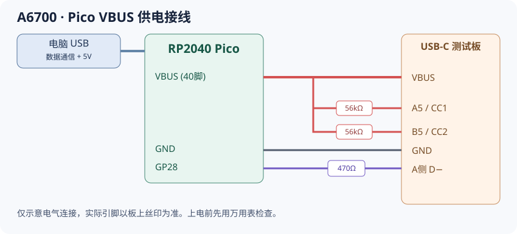

# 硬件说明

本方案用 RP2040 Pico 向相机冷启动接口发送 RAM 引导程序。电脑通过 USB 数据线为 Pico 供电，再由 Pico 的 VBUS 引脚向 USB-C 测试板提供 5V，无需额外 USB-A 供电板；加载完成后拆下测试板，再把数据线接到相机。

## 采购清单

| 材料 | 数量 | 选购规格与链接 |
|---|---:|---|
| 400孔面包板 | 1 | [400孔面包板](https://item.taobao.com/item.htm?id=732406384945&skuId=5762882484010)，用于搭建电阻及连接线 |
| 杜邦线 | 若干 | [连接线](https://detail.tmall.com/item.htm?id=607840828125)，按排针选母对母／公对母，尽量用短线 |
| RP2040 Pico | 1 | [Pico 开发板](https://detail.tmall.com/item.htm?id=708680626238)，选能引出 VBUS、GP28、GND 的 RP2040 板；可选已焊排针、Type-C 口版本 |
| USB-C 24P 测试板 | 1 | [Type-C 测试板](https://detail.tmall.com/item.htm?id=650876007247)，选择「TYPE-C测试板 公头」，核实引出下图节点 |
| 56kΩ 电阻 | 2只 | [56kΩ 电阻](https://detail.tmall.com/item.htm?adType=orgqzt&from=cart&id=13302997879&skuId=5887392058719)，分别用于 CC1、CC2 |
| 470Ω 电阻 | 1只 | [470Ω 电阻](https://detail.tmall.com/item.htm?adType=orgqzt&from=cart&id=13302997879&skuId=5887392058692)，串接 GP28 与 D− |
| 其他 | 按需 | 支持数据的 USB 线、万用表、焊接／绝缘材料、相机及电池 |

链接是采购参考，同一商品页有多种规格，按上表选。当前不包含 Pico 2 的验证记录。

## 接线



Pico 用一根 USB 数据线连接电脑，同时负责串口通信及 5V 供电；USB-C 测试板不再单独连接 USB-A 电源。以下节点图可用于核对，以板上丝印及实际连通关系为准，不能凭线色判断。

```text
电脑 USB 数据线 ──────── Pico USB 数据口（注入后移到相机）

Pico VBUS（物理40脚） ──── 测试板 VBUS
                 ├── 56kΩ ─── A5 / CC1
                 └── 56kΩ ─── B5 / CC2
Pico GND ────────────── 测试板信号 GND
Pico GP28 ── 470Ω ───── 测试板 A侧 D−（A8旁）
```

- GP28 是 GPIO 编号，**不是物理第28脚**。5V 不能直接接入 GP28。
- A5、B5 分别经过电阻接5V，不能直接短接。
- Pico 的 VBUS 是 USB 输入 5V（物理40脚），**不要接到 VSYS 或 3V3**；本方案针对普通 RP2040 Pico，兼容板需先核对供电引脚。
- Pico 的 3V3、测试板 A8/B8 及其余未列明的信号脚留空；无需独立 USB-A 取电。
- 首次接相机前，先断开相机，用万用表检查共地、短路和极性；Pico 连电脑、测试板空载时，测试板 VBUS、A5、B5 对 GND 应接近 5V。避免 USB 电源过载，裸露接点须绝缘。

接好后按[操作手册](操作手册.md)的上电顺序执行。加载完成后必须**先拔整个测试板，再移数据线到相机**。
